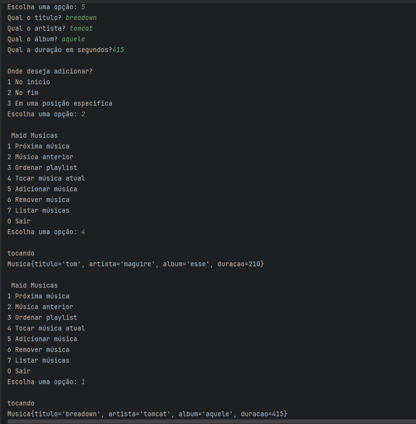

Trabalho AP2 Estruturas de Dados - Pilhas, Filas e Listas Ligadas

3.1. Identificação
Lucas Leonardo Toterol

3.2. Introdução

A implementação manual de estruturas de dados permite compreender melhor e
praticar o conteúdo visto em aula. Além disso, ajuda a desenvolver a lógica 
necessária para manipular diferentes variáveis e referências entre classes.

3.3. Implementação

Cada nó possui referências para o nó anterior e o próximo, permitindo percorrer a 
lista nos dois sentidos.

Quando a estrutura está vazia ou o elemento procurado não existe, o programa verifica
essa condição e não realiza a operação, evitando erros.

A atualização das referências exige bastante atenção e testes para garantir que tudo 
funcione corretamente. Por exemplo, ao inserir um elemento no início de uma lista, ele
passa a ser o novo início, enquanto o antigo início passa a ser o próximo elemento. 
As demais referências também precisam ser mantidas corretamente para preservar a conexão entre todos os nós.

3.4. Evidências de Execução

3.5. Conclusão

A maior dificuldade foi lidar com tantas variáveis e classes ao mesmo tempo, 
principalmente ao manipular as referências entre os nós. Entender qual nó deveria
apontar para o próximo ou para o anterior exigiu bastante atenção, testes e correções.
Quase perdi minha sanidade.